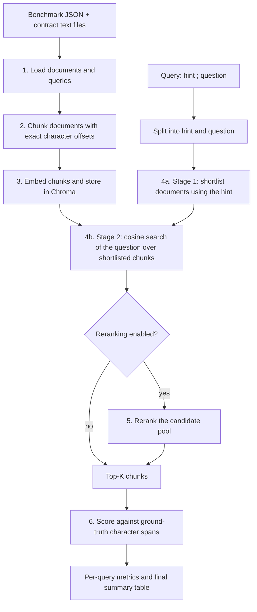

## The problem

Legal question answering over contracts fails most often at the retrieval step: if the clause that answers the question is not among the passages handed to the language model, no amount of prompting fixes the answer. Evaluating retrieval for legal text is hard for three reasons, and this project addresses each.

| Challenge | Why it matters | How this project addresses it |
|---|---|---|
| **Answers are precise spans inside very long documents** | A contract is tens of thousands of characters; the answer may be a single clause. Whole-document or page-level scoring hides retrieval quality. | Chunks carry exact `(start, end)` character offsets and are scored against the benchmark's **character-level ground-truth spans** (precision, recall, F1). |
| **Searching a whole corpus for one clause is noisy** | Many contracts contain near-identical boilerplate, so a clause from the wrong contract is easily retrieved. | **Two-stage retrieval**: first shortlist the likely contract(s) using the document hint in the query, then search chunks only inside that shortlist. |
| **Embedding similarity is not the same as relevance** | A chunk can be topically similar to a question without answering it, and the true answer may rank below the top few. | An optional **reranker** re-scores a larger candidate pool by reading query and passage together. |
| **Experiments are expensive and hard to repeat** | Embedding hundreds of contracts costs time and money; changing one setting should not redo everything. | Embeddings are cached in an on-disk **Chroma** database keyed by model, chunking scheme and exact chunk content. All settings live in one `config.py`. |
| **Chunk offsets can silently drift** | If chunk offsets are wrong, every metric is wrong. | Offsets are verified on every run (spot check and chunk-overlap check), and whitespace-only fragments are never indexed. |

---

## How the pipeline works

Each query in the benchmark has the form `"<document hint>; <question>"`, for example:

> `Consider the Sponsorship Agreement between Hydron Technologies, Inc. and Miami Dolphins, Ltd.; What are the insurance requirements under this contract?`

The text before the first `;` is used to find the contract. The text after it is the question used to find the clause.



| Step | What happens | Module | Main function(s) |
|---|---|---|---|
| 1 | Load the benchmark and the contract texts. | `data_loader.py` | `list_first_n_documents`, `load_benchmark_fixed_docs`, `load_benchmark` |
| 2 | Split every document into chunks with exact offsets. | `chunking.py` | `chunk_documents`, `fixed_chunk`, `structure_chunk` |
| 2b | Verify offsets and chunk overlaps. | `sanity_checks.py` | `spot_check_offsets`, `check_chunk_overlaps` |
| 3 | Embed chunks (batched) and persist them in Chroma. | `embeddings.py`, `retrieval.py` | `_embed_chunks_raw`, `build_chroma_collection` |
| 4a | Stage 1: rank documents against the hint and keep a small shortlist. | `retrieval.py` | `split_query`, `DocumentMetadataIndex` |
| 4b | Stage 2: embed the question and run cosine search restricted to the shortlist. | `retrieval.py` | `chroma_search` |
| 5 | Optional: rerank the top candidates. | `reranking.py` | `llm_rerank` |
| 6 | Compare retrieved chunks with the ground-truth spans. | `evaluation.py` | `evaluate_query`, `micro_prf` |
| - | Orchestrates everything and prints the summary. | `pipeline.py` | `run` |

---

## Project structure

```
.
├── main.py             # entry point: loads .env and calls pipeline.run()
├── pipeline.py         # run(): wires all steps together
├── config.py           # every tunable setting (edit this, nothing else)
├── data_loader.py      # step 1: benchmark and document loading
├── chunking.py         # step 2: fixed-size and structure-aware chunking
├── sanity_checks.py    # offset verification
├── embeddings.py       # step 3: Voyage / Cohere / local embedding backends
├── retrieval.py        # step 4: stage-1 document index, Chroma store, stage-2 search
├── reranking.py        # step 5: Voyage / Gemini / Anthropic rerankers
├── evaluation.py       # step 6: character-level metrics
├── requirements.txt
├── .env                # your API keys (not committed)
├── data/
│   ├── benchmarks/cuad.json
│   └── corpus/cuad/*.txt
└── chroma_db/          # created automatically on first run
```

Import direction is one-way (`config` at the bottom, `main` at the top), so there are no circular imports.

---

## How chunking works

Chunking is done **once** and shared by every embedding model. It works in characters, not tokens, because the benchmark's ground truth is expressed as character offsets, so no token-to-character conversion is needed.

Every chunk is a dictionary: `{"text", "start", "end"}`, and `document[start:end] == text` always holds.

| Scheme | `CHUNKING_SCHEME` | Behaviour | Parameters |
|---|---|---|---|
| **Fixed** | `"fixed"` | Recursive character splitter that prefers paragraph, line, sentence and word boundaries before cutting mid-word. | `FIXED_CHUNK_SIZE = 500`, `FIXED_CHUNK_OVERLAP = 100` |
| **Structure-aware** | `"structure"` | Detects the document's own structure and makes each section a chunk. Sections larger than the limit are split with the fixed splitter. | `STRUCTURE_MAX_CHUNK_SIZE = 800`, `STRUCTURE_CHUNK_OVERLAP = 100` |

### Structure detection

The structure-aware chunker tries progressively weaker signals and uses the first one that fires. The method used is printed for each document.

| Tier | Signal | Typical document |
|---|---|---|
| 1 | Headings: numbered, roman or lettered, ALL-CAPS lines, short title-case lines | Contracts with numbered articles |
| 2 | Blank-line-separated paragraphs | Plain prose |
| 3 | Single-newline lines (one item per line) | Text converted from HTML |
| 4 | Sentence boundaries | Unformatted text |
| 5 | Nothing detected: whole document as one segment, then fixed splitting | Fallback |

### Offset safety

| Safeguard | What it checks |
|---|---|
| Exact-substring recovery | Splitter output is mapped back to its position in the source text; a chunk that cannot be located raises an error. |
| Whitespace-only pieces skipped | Splitter fragments that contain no text (for example a lone newline) are discarded, so they are never embedded or scored. |
| `spot_check_offsets` | Samples chunks and confirms the slice at `(start, end)` equals the chunk text. Reports how many chunks have repeated text. |
| `check_chunk_overlaps` | Flags any chunk that overlaps its predecessor by more than the configured overlap, which indicates a mis-recovered offset. It should print `0`. |

---

## How retrieval and reranking work

### Stage 1: document shortlist (from the hint)

Each document is represented by its **file name** and the **first `METADATA_HEADER_CHARS` characters** (its header, where parties and title usually appear). The query hint is matched against those representations.

| `METADATA_METHOD` | Matching | Cost | Best when |
|---|---|---|---|
| `bm25` | Lexical BM25 (`k1 = 1.5`, `b = 0.75`) over lower-cased alphanumeric tokens with stop-words removed. File-name tokens count `METADATA_FILENAME_WEIGHT` times. | Free, no API calls | The hint repeats party or contract names (the usual case). |

The shortlist keeps at most `METADATA_TOP_DOCS` documents; for BM25 it also drops documents scoring below `METADATA_MIN_SCORE_RATIO` of the best score.

**Fallback:** a query without a separator (or with an empty side) skips stage 1 and searches **all** documents with the full query text, so no query is ever dropped. Set `METADATA_RETRIEVAL_ENABLED = False` to disable two-stage retrieval entirely and get a whole-corpus baseline.

### Stage 2: chunk search (from the question)

| Item | Behaviour |
|---|---|
| Query text | Only the **question** (text after the separator) is embedded, with the provider's query input type. |
| Index | Chroma, cosine space. Chunks are stored with their file path and offsets. |
| Filter | Search is restricted to chunks whose `file_path` is in the stage-1 shortlist. |
| Score | `cosine similarity = 1 - distance`. |
| Output | The ranked list of chunks; the top `TOP_K` are scored (or passed on as the candidate pool when reranking). |

### Embedding cache (Chroma)

One collection is created per **(provider, model, chunking scheme, exact chunk content)**. The collection name includes a hash of every chunk's path, offsets and text.

| You change... | Effect on the next run |
|---|---|
| Embedding model, chunking scheme or sizes, document set, chunker code | New collection name: everything is **re-embedded**. |
| `TOP_K`, reranker settings, stage-1 settings, `NUM_QUERIES` | **No re-embedding**; the cached collection is reused (`0 to embed`). |
| `CHROMA_REBUILD = True` | Deletes this run's collection and re-embeds. |

### Reranking (optional)

When `RERANK_ENABLED = True`, retrieval for each query becomes:

1. Cosine search (inside the stage-1 shortlist) returns a candidate pool of `RERANK_CANDIDATE_POOL` chunks in cosine order.
2. The reranker scores every candidate against the question.
3. The pool is re-sorted by score (ties keep cosine order) and the top `TOP_K` are evaluated.

| Aspect | Voyage reranker | LLM rerankers (Gemini / Anthropic) |
|---|---|---|
| Input | Question + chunk texts sent directly to a reranking endpoint | One prompt with the question and all candidates (each truncated to `RERANK_MAX_CHARS_PER_CHUNK`) |
| Output | A relevance score per chunk | JSON array of `{index, score}` (0-10), parsed tolerantly; missing indices fall back to cosine order |
| Determinism | Score-based | Gemini uses `temperature=0`; Anthropic uses default sampling unless changed |
| Cost | One cheap call per query | One LLM call per query |

If a rerank call fails for a query, that query falls back to its cosine-only metrics and the failure is counted. The run ends with a note such as `[note] N of M queries fell back to cosine-only metrics`, so a silently broken reranker is visible.

The summary reports the reranked results as a **separate row** next to the cosine-only row for each embedding model.

---

## Evaluation metrics

| Metric | Formula | Meaning |
|---|---|---|
| `Char precision@k` | overlap chars / retrieved chars | How much of what we retrieved was the answer. Low if chunks are large and mostly irrelevant. |
| `Char recall@k` | overlap chars / ground truth chars | How much of the answer we retrieved. |
| `Char f1@k` | 2·P·R / (P+R) | Combines precision and recall. It is 0 if both are 0. |
| `Hit rate` | 1 if any top-k chunk shares at least 50% characters with the ground truth, else 0 | Did we get any of the answer. |
| `MRR` | 1 / rank of the first top-k chunk that has atleast 50% of the ground truth, else 0 | How high up the first useful chunk was. A first hit at rank 1 gives 1.0, rank 2 gives 0.5, rank 4 gives 0.25. |

Overlap chars refer to the total matching characters the chunks have with the ground truth. To avoid counting repeated characters, we take the union of our top k chunks to get total unique matching characters our retrieved text contains. For a chunk to have a valid overlap, it must share a common source with the ground truth. 

Retrieved chars refer to the total characters covered by the top-k chunks after merging.

Ground truth chars refer to the total charcaters covered by the ground truth span.

---

## Setup

**Requirements:** Python 3.10 or newer is recommended.

```bash
git clone <your-repo-url>
cd <your-repo>
python -m venv .venv
source .venv/bin/activate          # Windows: .venv\Scripts\activate
pip install -r requirements.txt
```

`requirements.txt` lists the core packages (`numpy`, `python-dotenv`, `chromadb`, `langchain-core`, `langchain-text-splitters`) plus provider SDKs. Install only what you use:

### Data layout

The benchmark data is not included. Obtain LegalBench-RAG as described by its authors (see [References](#references)) and place the CUAD files here, matching `BENCHMARK_PATH` and `CORPUS_ROOT` in `config.py`:

```
data/
├── benchmarks/
│   └── cuad.json            # {"tests": [{"query": ..., "snippets": [{"file_path": ..., "span": [start, end]}]}]}
└── corpus/
    └── cuad/
        ├── <contract 1>.txt
        └── ...
```

The `file_path` values in the benchmark (for example `cuad/<contract>.txt`) must resolve under `CORPUS_ROOT`.

---

## Configuring API keys

Keys are read from **environment variables**. `main.py` calls `load_dotenv()`, so the simplest option is a `.env` file in the project folder.

| Variable | Required when |
|---|---|
| `VOYAGE_API_KEY` | Using Voyage embeddings or the Voyage reranker |
| `COHERE_API_KEY` | Using Cohere embeddings |
| `GEMINI_API_KEY` | `RERANK_PROVIDER = "gemini"` |
| `ANTHROPIC_API_KEY` | `RERANK_PROVIDER = "anthropic"` |

Local embeddings (`provider: "local"`) need no key.

**Option A: `.env` file** (recommended)

```env
VOYAGE_API_KEY=your-voyage-key
# COHERE_API_KEY=your-cohere-key
# GEMINI_API_KEY=your-gemini-key
# ANTHROPIC_API_KEY=your-anthropic-key
```

Add `.env` to `.gitignore` so keys are never committed:

```bash
echo ".env" >> .gitignore
```

**Option B: set in the shell**

| Shell | Command |
|---|---|
| macOS / Linux | `export VOYAGE_API_KEY="your-voyage-key"` |
| Windows PowerShell | `$env:VOYAGE_API_KEY = "your-voyage-key"` |
| Windows cmd | `set VOYAGE_API_KEY=your-voyage-key` |

A missing key raises a clear error naming the variable, only when that provider is first used.

---

## Running the project

Run from **inside the project folder**, because `data/` and `chroma_db/` are resolved relative to it.

```bash
python main.py
```

What you will see, in order:

| Output | Meaning |
|---|---|
| `Loaded N document(s), M queries.` | The documents and queries selected by `config.py`. |
| `Offset spot-check: ... correct` and `Chunk-overlap check: 0 chunk(s)` | Chunk offsets are verified. Investigate anything other than 0 flagged chunks. |
| Per-document chunk counts and structure method | How each document was chunked. |
| `Chroma collection '...': N chunks stored, X to embed.` | `X > 0` on the first run; `0` when the cache is reused. |
| Per-query blocks | Stage-1 shortlist, ground-truth spans, each retrieved chunk with its overlap and score, and per-query metrics. |
| `--- <model> (cosine only) averages over N queries ---` | Aggregate metrics for cosine retrieval. |
| `--- <model> + rerank averages ... ---` | Aggregate metrics with reranking (when enabled). |
| `SUMMARY` table | One row per model (and per reranked variant). |

**Cost note.** Embedding cost depends on the number of **documents** (`MAX_DOCUMENTS`), not the number of queries. In fixed-subset mode every one of those documents is chunked and embedded, even if no selected query refers to it. After the first run the cache makes repeat runs nearly free.

---

## Configuration reference

All settings are in `config.py`. Defaults shown are the values shipped in that file.

### Data

| Setting | Default | Meaning |
|---|---|---|
| `BENCHMARK_PATH` | `data/benchmarks/cuad.json` | Benchmark file. |
| `CORPUS_ROOT` | `data/corpus` | Root folder of contract text files. |
| `MAX_DOCUMENTS` | `200` | Number of documents to load (CUAD has 462). |
| `NUM_QUERIES` | `1000` | Maximum number of queries to evaluate. |
| `USE_FIXED_DOCUMENT_SUBSET` | `True` | `True`: use the first `MAX_DOCUMENTS` files (sorted by name) and keep queries whose ground truth lies entirely inside them. `False`: pick queries first and load the documents they reference. |
| `FIXED_DOCUMENT_SUBDIR` | `"cuad"` | Sub-folder of the corpus used in fixed mode. |

### Chunking and retrieval

| Setting | Default | Meaning |
|---|---|---|
| `CHUNKING_SCHEME` | `"structure"` | `"fixed"` or `"structure"`. |
| `FIXED_CHUNK_SIZE` / `FIXED_CHUNK_OVERLAP` | `500` / `100` | Fixed chunker, in characters. |
| `STRUCTURE_MAX_CHUNK_SIZE` / `STRUCTURE_CHUNK_OVERLAP` | `800` / `100` | Structure chunker limits, in characters. |
| `TOP_K` | `4` | Chunks retrieved and scored per query. |
| `MIN_HIT_OVERLAP_FRAC` | `0.5` | Overlap fraction required for a chunk to count as a hit. |
| `METADATA_RETRIEVAL_ENABLED` | `True` | Turn two-stage retrieval on or off. |
| `METADATA_QUERY_SEPARATOR` | `";"` | Separates the hint from the question. |
| `METADATA_METHOD` | `"bm25"` | `"bm25"`, `"embedding"` or `"hybrid"`. |
| `METADATA_TOP_DOCS` | `3` | Maximum documents kept after stage 1. |
| `METADATA_MIN_SCORE_RATIO` | `0.5` | BM25 only: drop documents below this fraction of the best score (`0` = off). |
| `METADATA_HEADER_CHARS` | `1500` | Leading characters of each document used as its header. |
| `METADATA_FILENAME_WEIGHT` | `3` | Weight of file-name tokens in BM25. |

### Models, storage and reranking

| Setting | Default | Meaning |
|---|---|---|
| `MODELS` | Voyage `voyage-4-large` | List of `{"provider", "name"}` embedding models to compare. |
| `USE_CHROMA` | `True` | Persist embeddings on disk. `False` re-embeds every run. |
| `CHROMA_DIR` | `chroma_db` | Database folder. |
| `CHROMA_REBUILD` | `False` | Delete and rebuild this run's collection. |
| `CHROMA_ADD_BATCH` | `500` | Chunks embedded and saved per step. |
| `RERANK_ENABLED` | `False` | Enable reranking. |
| `RERANK_PROVIDER` | `"gemini"` | `"voyage"`, `"gemini"` or `"anthropic"`. |
| `RERANK_MODEL` | `"gemini-3.5-flash-lite"` | Model name for the chosen provider (for Voyage, `"rerank-2.5"`). |
| `RERANK_CANDIDATE_POOL` | `20` | Cosine-ranked chunks handed to the reranker. Must be at least `TOP_K`. |
| `RERANK_MAX_CHARS_PER_CHUNK` | `650` | Per-chunk truncation in the LLM prompt. Ignored by the Voyage reranker, but the setting must still exist in `config.py`. |
| `ANSWER_PREVIEW_CHARS` | `100` | Characters of each retrieved chunk printed. |

---

## Caveats and interpreting results

| Topic | What to know |
|---|---|
| **Queries include a document hint** | Stage 1 uses the hint to identify the contract, so the task is closer to "find the clause inside a known contract" than to whole-corpus search. Results are not directly comparable to published baselines that retrieve from the full corpus using the question alone. |
| **Precision is low by construction** | Chunks (up to 800 characters) and `TOP_K` chunks are large compared with a typical answer span, so precision stays low even at high recall. Compare precision across configurations, not against 1.0. |
| **Reranking helps ranking more than precision** | At fixed `TOP_K`, a reranker tends to raise recall, hit rate, top-1 and MRR. Precision can stay flat or dip slightly because the reranked chunks may be longer. Use a smaller `TOP_K` to see precision benefits. |
| **Duplicate documents** | CUAD contains near-identical copies of some contracts (for example files ending in `(1)`). If both are shortlisted, only the one in the ground truth counts as a hit. |
| **Small runs are noisy** | With about 80 queries each query moves a metric by more than a point. Use the smoke test to catch bugs, not to rank configurations. |
| **Changing the chunker invalidates the cache** | Any change to chunk content creates a new collection and a full re-embed. |

---

## Troubleshooting

| Symptom | Likely cause and fix |
|---|---|
| `ImportError: cannot import name '...' from 'config'` | A module imports a setting that is missing from `config.py`. Restore the setting (for example `RERANK_MAX_CHARS_PER_CHUNK` must exist even when using the Voyage reranker). |
| `ValueError: Unknown RERANK_PROVIDER: 'voyage'` | The Voyage branch in `llm_rerank` is mis-indented or placed after the old provider check. It must run before `if provider not in _RERANK_CALL_FNS`. |
| `[note] N of N queries fell back to cosine-only` | The reranker call fails for every query. Read the `[rerank failed]` message printed for a query. |
| `Set the ..._API_KEY environment variable.` | The key is not set, or `.env` is not in the folder you run from. See [Configuring API keys](#configuring-api-keys). |
| Everything is re-embedded unexpectedly | The model, chunking scheme, chunk sizes or document set changed. Compare `config.py` with the earlier run. |
| `Chunk-overlap check` prints a non-zero count | Chunk offsets may be mis-recovered. Inspect the printed `SUSPECT` lines. |
| File-not-found warnings for corpus files | `file_path` values in the benchmark do not resolve under `CORPUS_ROOT`. Check the folder layout. |
| Rate-limit or 5xx errors from a provider | Calls retry with exponential backoff. For persistent limits, lower `CHROMA_ADD_BATCH` or retry later. |
| Chroma errors opening an old database | Use the same `chromadb` version that created it, or delete `chroma_db/` and rebuild. |


